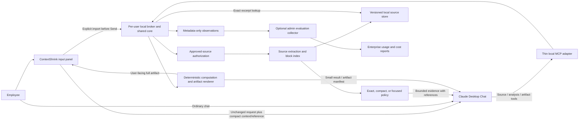

# ContextShrink for Claude Desktop Enterprise

This revised plan builds an MCP-first ContextShrink savings suite: current-message preparation before submission, compact tool/source context, deterministic computation, efficient retrieval, concise response defaults, and server-rendered artifacts. It preserves exact source excerpts and measures total Enterprise cost per successful task. **Local files and documents remain the first pilot**, followed by the current-input and output-saving paths requested by the user.

The scope is every practical, testable savings mechanism around a chat using ContextShrink. Mechanisms requiring an input panel, companion, user/admin settings, or demonstrated host capabilities are explicitly distinguished from ordinary MCP tools. Earlier chat-history rewriting and mandatory new-chat checkpointing are not part of the requested workflow.

Planning and internal review are complete. Phases A-C have local implementations
with targeted runtime, broker, retrieval, fidelity, and payload-evaluation
coverage; the phase notes record each command and its limits. User-reported
basic live Desktop checks exist for A and B, but broader live error/lifecycle
behavior, cross-SID ACLs, cloud-provider behavior, Phase C client compatibility,
and whole-task Enterprise billing remain unverified. Phase C's synthetic A/B
evaluation is unfavorable on its captured example (the optimized task uses
more estimated tokens), so it supports no positive savings claim. Phase D now
includes a standalone local browser companion, explicit session-scoped recovery
imports, `reference_only`, and the manual CLI route described in
[`2026-10-14-claude-desktop-phase-d.md`](2026-10-14-claude-desktop-phase-d.md).
The synthetic real-broker/HTTP probe and local GUI review pass. This is not a
Claude Desktop composer hook or MCP App; native Tauri integration/packaging is
deferred, and target-app compatibility and billing remain unverified.
The current worktree verification reports 321 passed and 1 platform-specific
skip for the desktop MCP suite plus the MCP dependency-contract and CCR HTTP
compatibility tests; scoped Ruff checks pass. Live target-app and Enterprise
usage/billing validation remain external gates.

The user separately reports a Claude Desktop compact-mode check returning
`alpha`, `ready`, `periodic-heartbeat`, and `48` for the repeated-log fixture,
and a source-backed open of version `ddb02b…` returning Alex with deadline
`2026-11-30`. A later open returned `source_unavailable`, which is consistent
with removal/revocation but does not prove that lifecycle or identify why the
source became unavailable. These observations are separate from SDK test
results and do not establish general Desktop compatibility or billing savings.

Phase B is a reduced-scope, read-only consume pilot. The diagnostic profile
remains unchanged and is still the default. Source-byte quotas do not bound
worker RSS; a worker deadline timeout kills/restarts the worker and clears all
shared snapshots and handles. The companion adds no privileged broker
operation or root-grant API: it creates generated files only within the
explicit approved staging root and calls the existing read-only `open`
operation. Broader cross-SID, cloud-provider, target-app error/lifecycle, and
Enterprise billing checks remain pending, so the work does not establish full
Enterprise production readiness.

Phase C local implementation work for M2/M3/M10 is tracked separately in
[`2026-10-13-claude-desktop-phase-c.md`](2026-10-13-claude-desktop-phase-c.md).
The Phase D companion/CLI implementation and its remaining target-app and
product gates are tracked in
[`2026-10-14-claude-desktop-phase-d.md`](2026-10-14-claude-desktop-phase-d.md).
Local token counts remain estimates, and per-call raw-equivalent payloads are
counterfactuals rather than observed task savings. Full MCP/host overhead and
Enterprise billing require separate measurement; Phase C implementation does
not establish Claude Desktop compatibility or a dollar-savings claim. The
synthetic SDK report is `desktop/mcp/phase-c-eval-report.json`; live Phase C
Desktop checks remain pending.

## Delivery phases

| Phase | Delivery | Milestones |
|---|---|---|
| A | Local SDK verification and basic live Desktop discovery/open passed; broader client checks pending | M0 |
| B | Local implementation and basic live Desktop flow passed; broader security and enterprise checks pending | M1, M8 |
| C | Local retrieval, compression/selection, reversible formats and SDK payload evaluation passed; live Desktop and Enterprise validation pending | M2, M3, M10 |
| D | Local browser companion, session-scoped staging, reference-only packets and CLI implemented; target-app validation pending | M9 |
| E | Typed computation, fused reads, instruction pack, role-separated artifacts and companion browser implemented locally; live Desktop validation pending | M11, M12 |
| F | Digital documents, runtime packaging and installation | M4, M5 |
| G | Enterprise trials, suite hardening and beta rollout | M6, M7, M13, M14 |
| H | Optional advanced media/models, upstream adapters and hosted connector | Extensions |

Phase A's diagnostic-only fixture server is a capability spike, not the
production broker-backed source service. Phase B's planned scope and
outstanding acceptance gates are tracked in
`wiki/plans/2026-10-13-claude-desktop-phase-b.md`. Phase C implementation and
remaining live-app/billing checks are tracked in
`wiki/plans/2026-10-13-claude-desktop-phase-c.md`. Phase A's runtime evidence
and live-check limits are tracked in `wiki/plans/2026-10-13-claude-desktop-phase-a.md`.

## 1. Product outcome and boundary

An employee installs ContextShrink in Claude Desktop, approves sources, and enables the relevant tool profile. For files, ContextShrink searches/reads locally and returns bounded evidence. For the current outgoing message, the employee can prepare supporting context in a ContextShrink input panel before submitting it. For calculations and reports, the service can perform deterministic work and return a compact answer or artifact instead of asking Claude to reproduce a large dataset.

The employee keeps using their Claude Enterprise account for inference. Local processing does not mean local inference: returned snippets still go to Claude's hosted model. ContextShrink makes no separate model inference calls by default.

Supported savings surface:

| Surface | Planned capability |
|---|---|
| Approved local TXT, Markdown, JSON, log, CSV/TSV sources | Supported, subject to format-specific policies |
| Born-digital PDF and ordinary DOCX | Required document-beta milestone, after extraction validation |
| Current supporting text pasted into ContextShrink before Send | Inline compaction or source externalization through a companion; optional MCP App input panel |
| Ordinary text pasted/uploaded directly into Claude | No standard MCP interception; savings require preparation before that submission |
| Claude's new response | Concise user/admin instructions and deterministic output offloading; behavior is not a hard output-token cap |
| Already generated Claude response | No retroactive token-charge reduction |
| Existing chat history and host inference settings | No MCP rewriting; existing chat continues |
| Claude built-in tools or directly connected connectors | Outside the service path unless a supported adapter is deliberately configured |
| Desktop Chat | Primary tested surface |
| Claude Desktop Code, Cowork, web, mobile | Separate compatibility scope; do not infer support from Desktop Chat |

MCP servers expose tools/context while the host manages the conversation. Standard MCP does not intercept the native composer Send action, replace history, enforce Claude generation limits, or select its model/effort/cache parameters. [MCP architecture](https://modelcontextprotocol.io/specification/2026-07-28/architecture)

An MCP App can supply its own user input interface on a compatible host. That capability is tested in M0 and described in section 17; it does not create a hook into Claude's ordinary composer. The Windows companion is the supported fallback.

Success means lower total cost for equivalent successfully completed work without material loss of correctness, evidence, or usability. Some tiny/general chats have no useful compression opportunity and can become more expensive from enabled tool schemas or instructions. The optimization policy must support abstention; no positive saving is promised for every chat.

## 2. Internal review and decisions

Three independent reviewers covered architecture, implementation/security, and savings/evaluation, then re-reviewed the expansion to current-input and output savings. The decisions below include that expansion.

| Question | Decision and reason |
|---|---|
| Generic upstream MCP gateway first? | Start with local documents. A universal wrapper adds schemas, resources, authentication, and callbacks before proving value. |
| Reuse the legacy CCR MCP server directly? | Reuse compression primitives; build a separate Desktop service. Preserve proxy CCR semantics and existing tool contracts. |
| Lossless compression alone for documents? | Offer exact/compact/focused modes from the first text pilot. The current verified densifier is strongest on reversible JSON, and prose may remain unchanged. |
| Return a marker on repeated reads? | Never infer chat continuity from a process, connection, or server cache. Return self-contained useful content on every read. |
| Does retaining the original make partial output lossless? | No. Focused output omits material and must declare partial coverage. Original recovery is a separate guarantee. |
| Arbitrary truncation to meet a token budget? | Reject silent truncation. Paginate exact text or explicitly return focused excerpts with omitted coverage. |
| Dollar savings from the existing MCP ledger? | Do not use its fallback pricing as observed Enterprise savings. Add separate payload, modeled-cost, and Enterprise evaluation layers. |
| Native Claude comparison? | Mandatory. The raw gateway comparison isolates the feature, but native retrieval/upload is the commercial baseline. |
| MCP SDK upgrade? | First test the real Desktop/SDK combination. Keep the global pin unless required; isolate a newer runtime if necessary. |
| Heavy ML or external summarization? | Excluded from the first release. Deterministic retrieval and compression avoid extra inference cost and deployment burden. |
| Existing frozen desktop client? | Reuse the build approach, not the artifact: its build excludes tokenization and compression-related dependencies. |
| Current user message? | Prepare it before submission in a user-operated input panel. An MCP tool receiving it after Claude does cannot recover the initial input cost. |
| Output saving? | Avoid unnecessary generation and offload deterministic content. Post-generation shortening is not billed-output saving. |
| Any-chat concise defaults? | Offer a short user/admin-approved Claude instruction pack. Installing an MCP server does not automatically apply it. |
| Many optimizers, many tools? | Keep a small stable tool profile with typed operations; measure schema overhead and reliability before expanding it. |
| Companion and MCP store? | Use one per-user broker/core so a prepared source handle resolves in separate MCP processes. |
| Combined savings percentage? | Measure the full package and interactions. Do not add overlapping mechanism percentages. |
| General-chat baseline? | Include native normal and native tuned settings; publish zero/negative strata and bypass rates. |

Open decisions are limited to facts that the capability spike and pilot must establish: actual Desktop protocol compatibility, UV versus binary packaging, parser coverage, and the measured economic opportunity. These are milestone gates, not reasons to delay implementing the bounded prototype.

## 3. Current repository foundation

Repository observations, reviewed on October 13, 2026:

| Existing component | Reuse | Gap |
|---|---|---|
| `horizon/ccr/mcp_server.py` | MCP tool patterns and retrieval behavior examples | First file read returns full text; retrieval returns the whole original; paths are unrestricted; process cache assumes prior context; INFO logging includes arguments/results |
| `horizon/ccr/mcp_http.py` | Transport pattern | Bare HTTP route does not provide Enterprise authentication/isolation |
| `horizon/compress.py:481` | `densify()` for verified reversible encodings | Its verifier is primarily compacted-JSON oriented; no universal prose reduction guarantee |
| `horizon/transforms/lossless_compaction.py:467` | Repeated log/text/config blocks, search/path factoring with inverses | Character savings require token recount; ANSI stripping and diff metadata deletion are normalized, not byte-exact |
| `horizon/proxy/output_verbosity_policy.py` | Concise wording and completeness rules | Proxy inference-request mutation is unavailable to MCP; only wording can be adapted |
| `horizon/transforms/cross_turn_dedup.py` | Within-request duplicate factoring concepts | Assumes earlier original remains in model context; unsuitable for implicit cross-chat MCP state |
| `horizon/image/` | Image processing experiments | Recalibrate against actual Claude models; some helpers use OpenAI formulas or only save bandwidth |
| `horizon/transforms/tabular_ingest.py` | Parser/formatter ideas | Verify cells, empty rows, quoting, and numeric text before claiming semantic preservation |
| `horizon/mcp_registry/` | Installation framework | Existing Claude registrar targets Claude Code; Desktop requires separate registration |
| `horizon/paths.py` | Canonical config/workspace conventions | Add a separate Desktop state namespace |
| `horizon/savings_ledger.py` and pricing helpers | Scenario calculation patterns | Existing fallback rates and nonnegative counters are not sufficient for Desktop billing attribution |
| `horizon/evals/` | Fixture/reporting infrastructure | Similarity/keyword heuristics cannot be release-quality correctness gates |
| `desktop/client/build-client.ps1` | Windows frozen Python build pattern | Explicitly excludes `tiktoken`, `litellm`, and heavy packages; needs a separate MCP build |
| `api/`, `dashboard/` | Future account-level reporting | Additive metadata events only; do not mix estimates with proxy-observed provider usage |
| `desktop/app/` | Tauri UI, tray and app-data/build infrastructure | Add independent local mode and explicit context preparation; current login/forwarder workflow is not a pre-send integration |

The working tree contains substantial pre-existing changes. Implementation should use reviewed commits or an isolated checkout and avoid altering unrelated proxy/evaluation work.

## 4. Architecture



Separate the components:

1. **MCP adapter:** stable tool schemas, response serialization, compatibility, and protocol errors.
2. **Source layer:** approved roots, file permissions, extraction, block references, immutable versions.
3. **Policy layer:** exact pagination, reversible compaction, and focused extractive retrieval.
4. **Local broker/store:** shared bounded snapshots and cached computations, scoped to OS user/workspace/policy; used by the MCP adapter and user interface.
5. **Observability:** local payload estimates and runtime performance; separate admin billing collection.
6. **User interface/distribution:** local extension, pre-send companion, optional MCP App view, and platform-specific runtime.
7. **Deterministic operations:** filter/project/aggregate/compare and server-rendered artifacts.
8. **Answer contract:** optional saved concise Claude instructions and task-specific response requests, not an API injector.

The service must work with the hosted proxy stopped and without any Anthropic inference API key. A ContextShrink account can be optional for organization reporting; source access and local processing must not require routing documents through the existing proxy.

### Proposed file layout

```text
horizon/desktop_mcp/
  __init__.py
  __main__.py             # dedicated entrypoint
  server.py              # thin transport adapter and stable tool profiles
  broker.py              # shared per-user source/core owner
  ipc.py                 # bounded authenticated local messages
  roles.py               # MCP versus explicit user-interface permissions
  ingest.py              # user-provided supporting text/file/image sources
  prepared_packets.py    # unchanged request plus compact evidence/handles
  settings.py            # validated local/admin settings
  sources.py             # approved paths, catalog, source versions
  blocks.py              # provenance and exact selectors
  extractors/
    text.py
    structured.py
    pdf.py               # document milestone
    docx.py              # document milestone
  policy.py              # exact/compact/focused decisions
  compression.py         # Horizon adapter and inflation guard
  retrieval.py           # exact same-version retrieval
  store.py               # bounded versioned snapshots
  metrics.py             # signed observations, no assumed billing
  batching.py            # fused source reads and overlap/provenance handling
  operations.py          # typed predicates/projection/aggregates/diff
  artifacts.py           # source/spec-driven rendering and export handles
  answer_contract.py     # user/admin instruction pack and response policies
  multimodal.py          # later calibrated image/OCR preparation
  delegates.py           # opt-in local ML / remote preparation backend

desktop/mcp/
  manifest.json
  pyproject.toml          # if an isolated UV runtime is needed
  build-windows.ps1
  smoke_client.py
  app/                    # optional host-supported MCP App interface

desktop/app/src/
  PrepareContext.tsx      # local companion input/preview
  ArtifactBrowser.tsx

desktop/app/src-tauri/src/
  context_service.rs
  clipboard.rs
  shortcuts.rs           # optional user-triggered action

tests/desktop_mcp/
  test_sources.py
  test_snapshot_store.py
  test_tool_contracts.py
  test_policy.py
  test_retrieval.py
  test_extraction.py
  test_protocol.py
  test_observations.py

horizon/evals/desktop_mcp/
  fixtures/
  task_manifest.py
  payload_benchmark.py
  enterprise_collector.py
  report.py
```

This is the target suite layout. Phase A currently implements the package
entrypoint, settings/contracts, diagnostic fixture backend/server, capability
probe and tests; the broker, production sources, compression and user
interfaces remain planned. Reuse safe helpers through explicit interfaces
rather than importing the proxy lifecycle or its global store.

## 5. Tool contract and user workflow

Start with the four core tools below. Benchmark a three-tool production profile with diagnostics in the companion, and a separate compute/artifact profile with two additional tools. Tool sets are stable within the configured profile; no per-chat `tools/list` mutation or unverified dynamic schema loading.

| Proposed tool | Inputs | Output |
|---|---|---|
| `contextshrink_search` | query, approved workspace/root, optional type filter, result limit | Ranked files/blocks, short snippets, versioned source references |
| `contextshrink_open` | approved path or source handle, mode, optional query, result budget, optional cursor | Useful exact/compact/focused view with coverage and provenance |
| `contextshrink_retrieve` | source handle, one exact selector, result budget, optional cursor | Exact excerpt of the same source version |
| `contextshrink_stats` | optional evaluation scope | Estimated delivered-payload reduction, retrieval overhead, errors, latency, counting basis |

Proposed compute/artifact additions are `contextshrink_analyze` (a small typed union of filters, projection, exact aggregates, validation and comparisons) and `contextshrink_render` (source IDs plus an allowlisted compact render specification). Batched ranges and fused search/open use the source tool contract with one global budget. Do not expose arbitrary Python, SQL, shell commands, or untyped executable payloads.

User import, clipboard capture, source grants, data deletion and export-path selection stay outside model-visible tools. A capability-gated App profile can add a workspace-opening tool and app-only operations, with permissions enforced separately from tool visibility.

Supported exact selectors: line range, Markdown section, JSON pointer, CSV/TSV row range, and later PDF page/block or DOCX paragraph/table references. Selectors form a validated tagged union; ranges and response limits are enforced server-side.

Return one concise model-facing text envelope initially. Do not duplicate full text in both `TextContent` and `structuredContent`. Keep originals outside model-facing fields, including metadata fields that might be serialized by the host. Verify actual host behavior before adding structured output.

Illustrative focused result:

```json
{
  "source_id": "cs_src_opaque",
  "version": "v_opaque",
  "mode": "focused",
  "coverage": "partial",
  "blocks": [
    {
      "ref": "section:renewal",
      "lines": [118, 130],
      "text": "Exact extracted source passage..."
    }
  ],
  "more_available": true,
  "next_cursor": null
}
```

The example is a contract sketch. Final field sizes and instructions must fit the response budget; verbose per-result statistics belong in the local event log or stats tool. Distinguish coverage of the requested page/section from coverage of the whole document. Pagination cursors bind caller/workspace, immutable source version, selector, mode, policy version, and budget; validate that binding on every continuation.

Employee workflow:

1. Install the approved extension.
2. Select folders outside the model through extension settings or the local folder picker.
3. Enable the connector in Desktop Chat.
4. Ask, for example, “Find the renewal conditions in my approved project documents and cite the relevant sections.”
5. Claude searches, opens focused evidence, and retrieves exact surrounding sections when necessary.
6. The employee can open the original document independently to inspect layout or details.

Provide brief tool descriptions/project instructions that encourage evidence retrieval and explain partial coverage. Test natural adoption as well as explicit “use ContextShrink” prompts. Do not claim that adding the extension guarantees Claude will use it for every document task.

## 6. Source access, versions, and storage

### Authorization

Use the local OS account as the initial principal plus explicitly configured workspace/root permissions. Treat an MCP-provided root as a hint, never as sufficient authorization. Approval settings are configured locally, not widened by tool arguments.

Canonicalize paths and verify root containment with path semantics, not string prefixes. Handle Windows junctions, symlinks, case normalization, UNC paths, alternate data streams, special devices, and traversal. Deny network shares by default; make them a separately configured capability if needed. Read using validated handles and file identity checks to reduce path-swap races.

Recheck grants and current OS access on every read, search, and cached retrieval. Revoking a root invalidates its handles and removes related retained/indexed data according to policy. A valid opaque ID cannot override a revoked permission.

OneDrive files need an explicit test category in this Windows environment. Distinguish legitimate cloud placeholders from path-escape reparse points; blanket rejection of all reparse points would reject ordinary user documents. Bound hydration time/size and return a clear unavailable-source result when content cannot be obtained.

Document passages are untrusted data. They cannot change server settings, grant roots, invoke programs, choose executable paths, or cause outbound requests. Source text is never interpreted as service instructions. Test malicious-document fixtures; these server boundaries do not establish immunity to model-level prompt injection.

### Versioning

Associate each opaque source handle with principal/workspace, source identity, original byte digest, extractor version, exact block map, and snapshot. Digests support integrity, not authorization. Random unguessable IDs and ownership checks apply on every lookup.

When a file changes, create a new version. A request for the old version returns that snapshot if retained; otherwise return an explicit expired/version-unavailable result. Never substitute a newer file while claiming it is the same original.

### Storage stages

**Developer pilot:** bounded in-memory snapshots owned by the shared per-user broker, with a one-hour proposed TTL and explicit expiry. Separate MCP adapters and the companion resolve the same handles through that broker. On broker restart, handles may expire; re-opening a source is an ordinary recovery action. Re-reading disk can satisfy an old reference only when the byte version matches.

Use SID-restricted local IPC, explicit caller roles, bounded messages/deadlines and cancellation. SID restriction identifies the OS user, not UI versus MCP authority. The trusted launcher/broker issues operation-scoped client credentials/capabilities; privileged operations never trust a caller-supplied role string. The MCP adapter receives no administrative/grant capability. MCP-origin requests can consume granted sources but cannot capture the clipboard, widen roots or configure the service. Commit an imported snapshot/handle before publishing a prepared prompt packet. A per-MCP-process memory store cannot implement the companion workflow.

Computed/cached results and managed artifacts carry their source dependencies. Recheck every dependent grant on preview, read and export, and invalidate managed derivatives after revocation. A user-owned file already exported outside the service cannot be recalled by broker revocation.

**Document beta:** configurable encrypted snapshot persistence if restart continuity is required. Store the encryption key in OS secure storage; never in the source database. Indexes can contain sensitive extracted text and need the same retention/access policy. Include “clear local data,” automatic expiry, disk/memory quotas, and safe recovery from partial writes.

Place runtime snapshots/indexes in private per-user local application storage outside the approved document folders and OneDrive synchronization. Verify Windows directory/file access controls. Expiry removes application access and retention; do not claim forensic secure erasure of SQLite/WAL pages. Encryption and retention need an explicit organization policy before production use.

Do not duplicate full originals into the existing process-global CCR store. Shared-store semantics and content-hash handles are unsuitable as the new authorization boundary.

### Caching

Cache extraction/compaction computations by principal/workspace, byte version, extraction version, mode, query, budget, and policy version. A computation cache avoids local CPU work, not necessarily Claude inference charges.

Repeated reads return useful content again. No “already in your context” markers. Host-managed conversation history can be compacted or unrelated requests can share the same process.

## 7. Compression and retrieval policies

| Mode | Guarantee | Typical use |
|---|---|---|
| Exact | All text in the requested scope is preserved; larger scopes paginate | Quotes, exhaustive review, exact values, audit |
| Compact | Verified reversible semantic encoding for supported structures | Repetitive JSON/records; eligible tabular data |
| Focused | Selected exact passages; full-document coverage is partial | Question answering over long prose |
| Overview | Titles, headings, tables/section inventory; no authoritative full summary | Orientation before choosing source sections |

For a fresh standalone result, call the existing densifier with `protect_recent=0` and an explicit counting-model assumption. Reversible compaction must preserve relevant scalar types, numeric values, nulls, Unicode, escaping, all rows, and ordering required by the source. Python floating-point JSON round-trip equality alone cannot prove high-precision numeric fidelity. Use precision-preserving parsing/number-token handling where supported, or route those sources to exact mode. Reject ambiguous duplicate JSON keys or preserve them in exact text. Byte-exact quotations and numeric lexical representations use exact mode.

Do not trust generic round-trip validation to prove every CSV/log/document transform safe. Add individually verified repeat/run/config/search/path folds from `lossless_compaction.py`. Verify against the original, account for escaping/marker collisions and bound expansion. ANSI stripping, diff index removal, and HTML main-content extraction require an explicit normalized/focused label. Unsupported reversible formats return exact text or focused excerpts.

Focused retrieval starts with deterministic local full-text/keyword ranking and section-aware chunks. Search neighboring blocks and include relevant heading/context. Merge overlapping excerpts within a self-contained result while preserving source locations, multiplicities and distinct provenance. Push typed predicates, field projection and result limits into the source layer before creating a large response. Avoid embeddings and model summarization initially; later optional backends have separate net-cost/fidelity gates.

For numerical calculations, provide precision-safe deterministic aggregate operations when supported. Scan all rows required by the predicate and return computation lineage, units, exclusions and counts. Sampling rows is not an exact aggregate. For unsupported exhaustive questions, use exact bounded scope/pagination or a complete artifact rather than focused samples.

Prose omissions are not called lossless, even when originals remain retrievable. Output carries partial coverage and references for omitted sections. A quality-tested opt-in selection policy can be enabled for supported document classes; otherwise preserve exact source blocks.

### Inflation guard and budgets

Count the complete result, including references, encoding explanation, coverage, and cursor. Compare against the equivalent raw gateway response. Keep compaction only if it saves a configured minimum after all overhead.

Initial tunable candidates, to be calibrated during the spike:

| Setting | Candidate default |
|---|---|
| Default estimated result-token budget | 2,000 |
| Maximum estimated result-token budget | 8,000 |
| Minimum gain to apply compaction | Greater of 64 estimated tokens or 5% |
| Maximum source file | 25 MiB, lower per-parser limits where needed |
| In-memory snapshot quota | 128 MiB per local workspace; bounded process-wide cap |
| Snapshot TTL | One hour |
| CPU/parser concurrency | Two workers with bounded queue |
| Focused retries/expansions | Observable; no fixed “already loaded” shortcut |

Local token counts are estimates and must include counter/version identifiers. A hard byte limit protects memory independently of estimated token budgets.

If exact/compact output exceeds budget, paginate at semantic boundaries. For a single oversized line, CSV cell, or JSON string, use explicitly referenced exact offset continuations where supported, or an actionable too-large error; do not overflow the budget or silently cut it. If a caller explicitly requests focused mode, select evidence and declare omitted coverage. If safe compression fails, use bounded exact output; if authorization or parsing fails, return an error. Never bypass authorization to recover from an error.

## 8. Document support and extraction fidelity

### Text-format pilot

Support UTF-8/recognized text encodings, TXT/MD, JSON, logs, and CSV/TSV. Bound recursion, row/field sizes, line lengths, and decoded output. Use strict decoding or a declared encoding; replacement-character decoding cannot support an exact-quotation guarantee. Treat unsupported encodings or malformed structured data as exact text only when safe.

Preserve source coordinates. Avoid dropping blank rows, silently coercing IDs/numbers, changing CSV quoting semantics, or normalizing negation/signs. Provide exact source text for citation and calculation tasks.

### PDF/DOCX milestone

Evaluate primary maintained parser libraries, then pin tested versions in the Desktop runtime. Start with born-digital PDF and ordinary DOCX paragraphs/headings/tables.

PDF support must preserve page/block provenance and identify extraction failures, password protection, missing text, and graphics-dependent sources. DOCX support must preserve paragraphs/headings/tables and detect unsupported tracked-change/textbox/image-dependent cases. Do not invent DOCX page numbers without a layout engine. Do not execute macros, resolve external links, or process embedded programs.

“Exact” means exact text in the extracted representation with a source reference. It is not a guarantee of rendered layout fidelity or complete extraction of every image/table/chart. Extraction fidelity is tested independently from compression.

Scanned/OCR PDFs, handwriting, complex graphics, and exhaustive layout-dependent analysis are outside the first beta. Unsupported or uncertain files return an actionable message and can be opened through the native workflow. No silent empty-document success. The selected PDF parser's extraction/memory limitations must inform worker limits; text extraction is not OCR. [pypdf extraction documentation](https://pypdf.readthedocs.io/en/stable/user/extract-text.html)

## 9. Runtime reliability and distribution

Use a dedicated entrypoint such as `python -m horizon.desktop_mcp`; a CLI alias can be added later. It connects to the shared broker without running the hosted proxy/forwarder. All protocol traffic goes to stdout; diagnostics go to stderr without source contents. Validate inputs and use actual MCP error results such as `CallToolResult(isError=true)`; an error string inside a normal successful result is insufficient. Read-only annotations describe source tools; artifact tools declare their confined local creation behavior. Annotations never replace authorization enforcement.

Capability spike requirements:

- Record actual Claude Desktop version/platform and announced protocol capabilities.
- Test initialization, tool listing/calls, errors, reconnect, restart, and two independent chats.
- Verify whether the pinned SDK is compatible with that Desktop version.
- Keep the SDK upgrade isolated if a separate runtime is necessary.
- Avoid dependencies on sampling, elicitation, conversation IDs, or resource rendering unless the target host demonstrably supports them.

Bound parser/compressor concurrency and queue length. Timeouts need cancellable workers; cancelling an awaiting thread alone does not stop CPU work. For risky/slow document parsers, use a worker process with time/memory limits. Resolve extraction and source-storage completion before exposing a handle.

Warm common tokenization/compression assets once without downloading large ML models on first use. Include lifecycle cleanup and explicit unavailable/degraded diagnostics. A compression failure can fall back to exact pagination; a permission failure cannot.

Package as an MCPB desktop extension. The pilot can test the current UV/Python runtime route, while a self-contained Windows build is the alternative for offline/restricted deployment. Select the simplest route that passes a clean-machine install without developer Python/Rust tooling. Signing and approved enterprise distribution are release requirements. [MCPB manifest](https://github.com/modelcontextprotocol/mcpb/blob/main/MANIFEST.md), [Claude desktop extension setup](https://support.claude.com/en/articles/10949351-getting-started-with-local-mcp-servers-on-claude-desktop)

Start Windows-first because the repository and test environment already support Windows. macOS release artifacts and signing are a separate matrix, not an assumed consequence of Windows success.

## 10. Savings model and honest reporting

Maintain three distinct quantities:

1. **Estimated delivered-payload reduction:** raw gateway estimate minus the entire returned result.
2. **Modeled economic opportunity:** explicit assumptions for model rates, cache mix, retained context, additional rounds, and service cost.
3. **Observed Enterprise consumption difference:** measured participant/task-window spend normalized by successfully completed work.

Keep signed deltas and failed/zero-gain attempts. Retrieval can erase savings or make a task cost more. Do not price unknown Desktop traffic at a universal fallback rate, or label local cache hits as provider cache savings.

For a complete task:

```text
ModelCost = uncached_input * input_rate
          + cache_write_5m * write_5m_rate
          + cache_write_1h * write_1h_rate
          + cache_reads * read_rate
          + billed_output * output_rate
          + other applicable billed charges

TotalTaskCost = sum(ModelCost over all measured requests and models)
              + preparation/delegation costs absent from that sum
              + incremental local/hosting/license cost

NetBenefit = TotalTaskCost_native - TotalTaskCost_package
```

Provider-reported billed output can include visible text, hidden reasoning and generated tool arguments. Do not add separate estimates of those components to an already inclusive reported total. Observed full-task spend already includes retrieval calls and extra output; do not subtract them twice. Delegated inference is added separately only if it is absent from the measured all-model total. Separate cost per task, cost per successful task including failed-attempt spend, and task latency.

The source-only opportunity scenarios below are not a combined suite forecast. Prompt preparation, output avoidance, computation, settings and caching interact; do not add their marginal savings percentages. Section 20 defines joint package evaluation and attribution.

Organization opportunity, before actual cohort results:

```text
GrossConsumptionSavingFraction
  ~= eligible_controlled_cost_share * routing_adoption * effective_reduction

NetBenefitUSD
  ~= baseline_consumption * GrossConsumptionSavingFraction
     - extra_model_usage - service_costs
```

Here `effective_reduction` means gross rate-weighted reduction before incremental retrieval/tool/model overhead. If using an observed net task reduction instead, extra model usage is already included and must not be subtracted again.

The eligible share is a **cost share**, not a total-token share. Expensive uncached source input and cheap cached history differ materially. The extension cannot observe its share of every Claude activity; supervised task observations and cohort analytics establish coverage.

Hypothetical scenarios, not forecasts; overhead is expressed as a percentage of baseline variable consumption:

| Scenario | Eligible cost share | Routing adoption | Effective reduction | Gross usage benefit | Added usage/service cost | Net usage benefit |
|---|---:|---:|---:|---:|---:|---:|
| Light document usage | 15% | 60% | 40% | 3.6% | 2.0% | 1.6% |
| Targeted document workload | 40% | 80% | 60% | 19.2% | 3.0% | 16.2% |
| Data-heavy supported workload | 65% | 90% | 70% | 40.95% | 5.0% | 35.95% |

The reduction assumptions for focused mode require successful task evaluation; they are not current lossless compressor measurements.

For an assumed $2,000 monthly consumption plus $1,000 fixed seats, the middle scenario saves $324 net, or 10.8% of the combined $3,000 bill. This illustrates the denominator; it is not a prediction for the user's account.

Current usage-based Enterprise plans separate consumption from fixed seat fees. Validate the actual test contract/settings and current rates before pricing the pilot. [Enterprise billing](https://support.claude.com/en/articles/11526368-how-am-i-billed-for-my-enterprise-plan)

## 11. Measurement implementation and Enterprise experiment

### Local event schema

Record metadata only:

```text
event_id, UTC timestamp, local principal/workspace identifier,
transport identifier (never called a conversation ID),
evaluation_task_id if supplied by the test harness,
tool, source/version identifiers, mode, policy/extractor version,
input_bytes, raw_equivalent_result_est_tokens, full_delivered_est_tokens,
count_basis, counter_version, configured_model_assumption,
retrieval_bytes/est_tokens, computation_cache_hit,
extraction/compression/total_latency, fallback/error reason
```

Source handles/digests can reveal correlations. Keep them local by default and pseudonymize when exporting. No raw text, paths, queries, credentials, or tool arguments in ordinary telemetry. Queries can contain sensitive business details.

A separate administrator collector stores Enterprise usage/cost buckets and evaluation window mappings. Never distribute the Analytics key to employee extensions.

Enterprise reports can separate uncached input, cache writes/reads, output, model, and product. Current per-user endpoint references support minute/hour/day aggregation; these are still time buckets without a direct MCP-call-to-inference join. Use isolated windows and report attribution uncertainty. [Enterprise usage reference](https://platform.claude.com/docs/en/api/python/beta/organization/analytics/user_usage_report/list), [Enterprise cost reference](https://platform.claude.com/docs/en/api/python/beta/organization/analytics/user_cost_report/list)

Cost/usage freshness differs from engagement metrics. Query after the report's refresh point, allow up to 24 hours for late data, and re-check revised totals. Use bounded windows and the returned refresh timestamp. Newer product mappings can include unified chat/Cowork; validate filters on the actual account. [Analytics guide](https://platform.claude.com/docs/en/manage-claude/analytics-api)

### Three baselines

| Arm | Purpose |
|---|---|
| A: Raw gateway | Same tool schemas/source access, requested scope and safety limits; exact results with bounded pagination; isolates compression/selection effect |
| B: ContextShrink | Compact/focused results plus exact retrieval; tests proposed product |
| C_normal: Native Claude | User's normal upload/retrieval/current settings; tests practical package value |
| C_tuned: Tuned native Claude | Same concise instructions/model/effort as the package; isolates ContextShrink-specific value |

Run the same authorized source snapshots and tasks in fresh conversations. Hold model/effort/settings constant within A/B and the controlled factorial comparisons. C_tuned matches the package's chosen settings; C_normal retains the user's recorded normal settings. Randomize/counterbalance arm order; a fresh conversation does not establish a cold provider cache. Record every page/retrieval call in every arm; the raw baseline must not receive unsafe unbounded responses or different requested-source access.

Build approximately 40 representative document tasks, repeated three times per tested arm where practical. Expand the corpus for pre-send prompts, source-free chats, output artifacts, calculations, repeated sources and full-deliverable writing. Include long prose QA, cross-document evidence, exact numeric lookup, negation/exceptions, exhaustive row questions, rare outliers, unrelated follow-ups, tiny/high-entropy data, multilingual content, updated/expired sources and unsupported documents. Evaluate complete multi-turn tasks, including requests for more detail and corrections. This is an initial engineering sample, not proof of a narrow population-level accuracy margin.

Predeclare supported workload strata, assignment, frequency weights, sample size, and stopping rule before collecting comparative outcomes. Report every assigned task, failed attempts, unsupported/bypassed share, and negative-cost strata. Unsupported visual-document tasks are reported separately from the predeclared supported text-document claims; do not remove unfavorable outcomes after observing results.

Use an independent blinded scorer with task-specific ground truth and required source citations. Penalize unsupported answers and silent missing evidence. Similarity and keyword scores remain diagnostics.

Controlled Enterprise pilot:

1. Confirm consumption-based billing, chosen model/settings, extension policy, and reporting availability.
2. Collect per-user timed bundles with no unrelated Claude activity in those windows.
3. Record participant/task IDs and UTC boundaries outside the model prompt where possible.
4. Wait for refreshed consumption reports; map bucket totals to known windows conservatively.
5. Compare paired total spend, successful-task count, retrieval rate, correctness, and latency.
6. For finer attribution, use minute buckets only when task windows and reporting resolution support it; otherwise compare complete bundles.
7. Expand to 5-10 users with alternating baseline/product periods and natural prompts.
8. Report weighted total costs, paired intervals, failure costs, and workload mix. Do not average percentage savings equally across tiny and large tasks.

If the primary-owner Analytics key is unavailable, start with documented usage/spend exports and local events; label the evidence coarser. Do not substitute API playground spend for Desktop Enterprise spend.

## 12. Implementation sequence and effort

Assume one experienced engineer, available reviewer, Enterprise admin access for the pilot, and Windows-first release. Estimates are engineer-days; some work can overlap but dependencies and billing data freshness add calendar time.

| Milestone | Work | Dependency | Estimate | Acceptance |
|---|---|---|---:|---|
| M0: Capability and baseline spike | Actual Desktop connection, protocol/SDK, raw prototype, chosen packaging route, source corpus | None | 2 days | Tools usable in two fresh chats; source/model/reporting constraints recorded |
| M1: Safe source and snapshot layer | Approved roots, versions, bounds, immutable blocks, expiry/errors | M0 | 4 days | Unauthorized paths denied; exact same-version recovery; no cross-chat seen state |
| M2: Tools and policies | Search/open/retrieve/stats, exact pagination, reversible JSON, focused text, full-result counts | M1, M8 | 4 days | First response useful; no silent truncation; round trips and inflation guard pass |
| M3: Evaluation and metadata | Fixtures, arm selection in local config, signed event log, baseline runner/reports | M2 | 3 days | A/B comparable; overhead and failures retained; no misleading dollar display |
| M4: Digital documents | PDF/DOCX extractors, anchors, table/numeric checks, unsupported detection | M1-M3 | 4-10 days | Extraction fidelity passes supported classes independently |
| M5: Distribution | MCPB/runtime build, clean-machine smoke, settings, signing/install/uninstall | M0-M4 | 3-10 days | Works without developer Python/Rust; roots configurable; rollback restores native workflow |
| M6: Enterprise pilot | A/B/C timed task bundles, refreshed billing collection, blind scoring | M3-M5 | 5 days plus data lag | Quality/cost/latency evidence and honest attribution report |
| M7: Beta hardening | Retention/encryption if needed, quotas, failures, UX, metadata export and docs | M6 | 4 days | All release gates; supported format list and measured scope published |
| M8: Shared broker and IPC | Per-user owner integrating M1 store, operation-scoped client authority, cross-process handles, lifecycle | M1; before M2 | 5-8 days | Companion and MCP resolve identical versions; unauthorized callers/roles rejected |
| M9: Current-input preparation | Explicit request/context fields, preview, inline/reference packets, manual copy | M2, M8 | 4-7 days | Request preserved; raw context not submitted first; no background clipboard access |
| M10: Broader reversible formats | Verified log/config/search/path/text folds and token gate | M2 | 2-4 days | Original round trips or normalized labels; no expansion bombs |
| M11: Batched deterministic work | Fused reads, projection/filtering, Decimal aggregates/comparisons | M1-M3 | 5-8 days | Global budgets, exact operations, fewer unnecessary model rounds |
| M12: Artifact delivery | Source/spec-driven renderers and local artifact browser | M5, M11 | 4-6 days | Full artifacts built server-side; short Claude response; safe local export |
| M13: Expanded economics | Output contract, native tuned baseline, ablations, full-package trial | M3, M9-M12 | 3-5 days | Input/output/settings/product effects separated; signed task costs |
| M14: Suite hardening | IPC, clipboard, source revocation, crash/update and UI rollback | M8-M13 | 3-5 days | Clean-machine multi-user/multi-chat and data exposure checks pass |

The document work M0-M7 is 29-42 engineer-days before shared IPC. This revision also requires M8 early, giving **34-50 days for a broker-backed document beta**. M8-M14 add 26-43 days in total to M0-M7, counting the broker exactly once: **55-85 engineer-days, approximately 11-17 working weeks for one engineer**, plus admin/signing/test-participant delays. Constrained document/Windows packaging gives the narrower 55-72-day suite range.

A broker-backed TXT/MD/JSON prototype is an early milestone around weeks 3-4 at the stated single-engineer estimates. Broker/companion work can overlap source-tool work if staffing permits; it is not postponed until after the document beta. The optional integrated MCP App adds a 4-8-day capability-gated UI stage or replaces some companion UI work after the spike. Advanced model/media/connector features below have separate estimates.

Recommended PR ordering:

1. Desktop adapter/core skeleton, settings, capability smoke and raw baseline.
2. Approved-root and versioned snapshot interfaces.
3. Shared broker IPC, scoped client authority and cross-process tests.
4. Exact block retrieval/pagination and tool contracts.
5. Verified compaction plus focused selection and response inflation guard.
6. Signed metadata and evaluation harness.
7. Current-message preparation and preview/copy.
8. Broader reversible formats and fused/batched source operations.
9. Deterministic aggregate/query operations.
10. PDF/DOCX extraction with scoped fidelity fixtures.
11. Source-driven artifact rendering and local browser/export.
12. MCPB/companion packaging and clean-machine installation.
13. Output contract, native tuned comparison and whole-package trials.
14. Enterprise reporting integration and reviewed evidence.
15. Suite privacy/clipboard/IPC hardening and beta lifecycle.
16. Optional separately proved MCP App interface and advanced backends.

Each PR includes relevant tests; do not run or rewrite the entire proxy system merely to land the new service. Shared-helper changes require existing caller regression checks.

## 13. Verification and release gates

### Required correctness/security checks

- Root traversal, prefix collision, junction/symlink, path-race, unsupported path kinds, revocation after caching.
- Malicious source instructions cannot modify settings, widen roots, invoke processes, or trigger network requests.
- File change between search/open/retrieve; expired versions; restart recovery.
- Byte/memory/queue bounds and parser timeouts; malformed/oversized documents.
- JSON values/types/rows/Unicode/escaping/order and ambiguous key handling.
- CSV blank/quoted/multiline cells, leading-zero IDs, high-precision values.
- Exact reference/citation mapping and versioned pagination.
- Two fresh/interleaved chats receiving useful results with the same process.
- Companion-created sources resolve from a separate MCP process; role separation and broker restart/expiry are explicit.
- Prepared current-message request, constraints, quantities, negation and exact-code requirements are preserved.
- Small/no-tool chats avoid planner/preparation calls and expose installed-schema/instruction overhead.
- Batch budgets, cancellation, source lineage and exact Decimal aggregates pass.
- Artifact export does not ask Claude to generate the full repeated content in tool arguments.
- Concise-output tests retain the full requested deliverable; detail requests and corrections count in the cost.
- No source text/query/credentials in runtime logs or exported events.
- Full response counts include envelopes, format explanation and pagination.
- Partial coverage clearly declared; exact/exhaustive questions avoid sampling.
- Real Desktop install, reconnect, timeout/error behavior and clean-machine launch.
- Existing MCP/CCR and proxy behavior remains compatible where shared code changes.

### Initial performance/economic targets

These targets are hypotheses to calibrate after M0, not measured promises:

| Gate | Initial target |
|---|---|
| Reversible formats | All deterministic round-trip fixtures pass |
| Critical facts/citations | Zero observed critical errors or inaccessible required evidence on golden tasks |
| Focused task quality | No material regression versus native baseline; formal noninferiority requires a powered larger sample |
| Selected large-result payloads | Aim for at least 30% median full-result reduction |
| Supported task economics | Aim for at least 15% lower observed variable cost per successful task versus the relevant native workflow; hypothesis, not universal guarantee |
| All-in economics | Delegated/preparation profiles also require positive total-task benefit after every backend/service cost; shifting spend alone does not pass |
| Savings uncertainty | For marketed percentage claims, positive lower confidence bound on predeclared weighted mean net benefit versus the named C_normal or C_tuned baseline, plus sufficient sample and transparent conditions |
| Warm text processing overhead | Aim for p95 below one second for an agreed source-size class |
| End-to-end task latency | Aim for p95 no more than 10% worse, unless users explicitly value the quality/cost tradeoff |
| Tool errors | Below 1% on supported normal workloads; denied/unsupported operations reported separately |
| Isolation | No unauthorized source access or version substitution |

If quality passes but cost does not, revise response budgets, selection strategy, or workflow scope and repeat affected comparisons under a new declared evaluation version. If native Claude is cheaper at equivalent quality, do not sell a savings claim for that workload. Release claims apply only to predeclared supported strata that pass; publish overall coverage and unfavorable strata instead of averaging away or hiding failures.

## 14. Rollout, operations, and rollback

Rollout sequence: developer text pilot, the user's controlled Enterprise document pilot, current-input/output suite pilot, 5-10 authorized testers, then restricted organization beta.

Extension/companion settings show approved roots, selected source/data permissions, supported formats, exact/compact/focused policy, retention and diagnostics. Root changes and data deletion occur outside model tools. Saved Claude instructions are a separately installed user/admin setting with its own rollback. Organization policy can lock settings without granting broader filesystem access.

Monitor local latency, timeouts, snapshots/quota evictions, extraction support, fallback modes, full-response payload deltas, and retrieval frequency. Track Enterprise billing separately; do not expose an admin collector endpoint or credential to employees.

Rollback is disable the relevant feature/profile, choose raw/exact policy, or uninstall the extension/companion. Stop the broker, clean retained data according to policy, revoke optional reporting/delegation credentials, and restore only ContextShrink-owned Claude instruction changes. Ordinary native chat continues; no model API base URL or Claude account token changes are needed.

Version the policy, extractor, response contract, fixture corpus, runtime, and installer. Record them in every evaluation report so a regression can be traced and a previous package can be restored.

## 15. Extensions after local value is proven

### One upstream MCP adapter

Estimated 5-8 engineer-days for one pinned read-only server, plus its auth/compatibility validation. Expose explicit compact tools with their own result schemas rather than claiming transparent arbitrary-tool wrapping.

Preserve or pass through unsupported images/audio/resources/errors. An upstream structured result must match its output schema; replacing it with a summary can violate that contract. Forwarding callbacks, subscriptions, resource reads, progress, cancellation, and auth expands scope beyond a simple text interceptor. [MCP tools](https://modelcontextprotocol.io/specification/2026-07-28/server/tools)

### Hosted Enterprise connector

Estimated 7-12 days only if identity, deployment, and tenant primitives already work; otherwise roughly 15-25 days. Add standards-compliant per-user auth, resource audience checks, tenant-scoped storage and audit, revocation, quotas, and retention. Do not reuse a single shared API key as per-user identity or pass Claude session credentials to upstream services.

A remote connector cannot read the user's local filesystem automatically. It needs authorized synced/uploaded sources or an explicitly designed local agent. Claude's remote connector requests originate from Anthropic's infrastructure, so the endpoint must be reachable there. [Remote connector requirements](https://support.claude.com/en/articles/11175166-get-started-with-custom-connectors-using-remote-mcp)

Generic gateways, model delegation, advanced visual/audio handling, cross-device synchronization and macOS fleet rollout remain separate measurable extensions, but their savings opportunities and gates are included in sections 16-21.

## 16. Comprehensive savings mechanism inventory

The suite optimizes complete successful work, not the smallest text at any cost. Implement high-confidence direct mechanisms first, conditional behavioral/UI mechanisms second, and experimental backends only after net-cost and fidelity evidence.

| ID | Mechanism | Route and benefit | Required boundary/gate |
|---|---|---|---|
| S01 | Current supporting context externalization | Pre-send UI imports raw data; short request + useful evidence + handle reaches Claude | Requires explicit input workflow; subsequent retrieval counts |
| S02 | Current-message inline compaction | Companion/App prepares reversible compact selected reference text before Send | Preserve the actual request; full-packet token gate |
| S03 | Optional request rewriting | User-previewed prompt editing can remove redundant prose or clarify the task | Lossy opt-in, no automatic intent rewriting; include follow-up effects |
| S04 | Reversible JSON/table encoding | Shared schema, compact records and repeated-value factoring | Exact types/precision/rows and decoding verification |
| S05 | Repeated log/text/config folding | Collapse exact runs/blocks with inverses | Marker collision/expansion limits; model reconstruction cost |
| S06 | Search/path grouping | Factor repeated file/directory prefixes | Locations/order remain recoverable; whole-result counting |
| S07 | Meaning-aware normalization | Selected formatting/boilerplate removal, HTML main-content extraction | Explicit normalized/focused mode; never general byte-lossless claim |
| S08 | Query pushdown | Typed filters, field projection, sorting and bounded limits before return | Complete requested scope; no silent sampling |
| S09 | Deterministic computation | Counts/sums/grouping/validation/comparisons from source data | Exact arithmetic, units/null rules and source lineage |
| S10 | Focused source retrieval | Return relevant exact sections instead of full documents | Partial coverage declared; exact expansion available |
| S11 | Within-result deduplication | Merge overlapping snippets and repeated source text | Preserve multiplicities and multi-source provenance |
| S12 | Batch/fused retrieval | Multi-range reads, search-plus-open and combined operations | One global budget; complete per-item errors; compare native parallel tools |
| S13 | Explicit incremental changes | Compare named immutable versions or read a requested log window | No assumption of remembered baseline; changed evidence self-contained |
| S14 | Computation/source cache | Reuse extraction, ranking, query and rendered artifacts | Saves local/upstream work, not automatically Claude inference |
| S15 | Exact verified result reuse | Reuse outputs keyed by inputs, dependencies and versions | Current authorization/freshness; MCP result still enters inference |
| S16 | Direct UI answers | Serve deterministic/exact reused answer in user UI without another Claude submission | Changes the interaction path; report inference bypass separately |
| S17 | Small stable schemas/results | Compact own definitions, concise metadata, single result representation | Preserve contract/permissions; no arbitrary other-server rewriting |
| S18 | Concise response contract | User/account/project/org instructions reduce unnecessary new output | Behavioral guidance, not hard cap; preserve requested detail |
| S19 | Avoid repeated generated material | Refer to precise sources/artifacts; prefer requested minimal edits over restating full files | Full files/narratives still delivered when requested |
| S20 | Source-driven artifact rendering | Local reports/tables/charts/templates from IDs and short specification | Full generated bodies in tool arguments are still billed output |
| S21 | Interactive data offloading | User explores full tables/artifacts through app-only UI operations | Host capability/data-exposure proof; no model turn for every filter |
| S22 | Bounded App-owned context | Keep only a small current app view summary/context | Replaces only App-owned context on a supported host; not chat history |
| S23 | Task-aware image preparation | Crop meaningful regions or downsample before transmission | Claude-specific resolution/token calibration and visual fidelity |
| S24 | OCR/transcript/frame extraction | Local text/time/region evidence can replace unnecessary bulk media | Optional; unsupported host/media types and lost visual/audio evidence disclosed |
| S25 | Local ML/embeddings | Optional relevance retrieval or selected-context compression | CPU/memory/download/quality cost; deterministic baseline retained |
| S26 | Optional preparation model | Summarizer/extractor/cheaper delegate behind explicit configuration | Separate billed work/privacy/retries; measure total net benefit |
| S27 | Cache-friendly own representations | Stable schemas, canonical outputs and no volatile per-result decorations | Host controls provider caching; do not claim hit/TTL control |
| S28 | User model/effort guidance | Choose adequate model/effort for a task where Desktop allows | User/admin setting; native tuned baseline; accuracy gate |
| S29 | Better errors and task completeness | Actionable bounded failures and exact evidence reduce retry/correction rounds | Full-task measurement; do not hide errors for shorter output |
| S30 | Savings-aware abstention/budgets | Skip low-value optimization; limit duplicate work and excessive expansion | Advisory estimates with unknown host costs; explicit exact fallback |
| S31 | Supported upstream adapters | Apply eligible source optimizers to additional connected data | Deliberately routed read-only adapter and preserved upstream contracts |

This is the current feasible design inventory, not a claim of universal savings or an automatic interceptor. The core service can be enabled in any compatible chat, but source-free chats may use no tools and receive only a separately configured concise-response preference.

### Mechanisms that do not receive model-token savings credit

- Gzip/zstd, ZIP storage, or smaller network JSON with unchanged model-visible content.
- Same-dimension image re-encoding when the provider processes identical visual dimensions.
- Compressing a prompt after Claude has already received the original.
- Hiding/truncating/compressing a Claude answer after generation.
- Moving a full Claude-generated report into tool arguments or an artifact.
- Claiming a local cache hit proves a provider prompt-cache hit.
- Calling a per-chat policy/optimization tool for every tiny prompt.
- Aggressive lossy omission that reduces answer quality or triggers extra clarification.
- Rewriting earlier conversation history through standard MCP.

## 17. Current-message preparation: App and companion

### Input contract

The input interface separates **Request** from **Supporting context**. Keep request text, constraints, quantities, negation, output requirements and exact code unchanged by default. Compression applies to user-selected supporting content. The preview shows exact/compact/focused differences and retained-source references.

Choose among:

1. **Pass through:** short/high-entropy data or uncertain semantics; no compression ceremony.
2. **Inline compact:** reversible useful context fits the response packet and avoids a retrieval round.
3. **Focused inline plus handle:** selected evidence answers the question; exact expansion is available.
4. **Reference only:** very large source is stored locally, with a short title/type/coverage cue and user request; compare extra lookup costs with native uploads.

Commit the source version and grant before creating the packet. Count every packet field and any later retrieval. A pointer-only packet is not necessarily cheaper if it introduces an unnecessary model round. Prefer useful evidence inline when economical.

### Optional MCP App-owned input panel

Test actual Claude Desktop support for MCP Apps, app-only tools and message/context APIs. If supported, the user can paste reference content into the App; app-only ingestion stores it without placing the raw body into model-visible tool arguments. Publish only the compact packet or handles to Claude.

App APIs can send a user message and update the App's own model context. Use those APIs only for compact relevant evidence; putting the full raw document into `updateModelContext` still exposes it to model input. Only the App-owned slot is replaceable; ordinary chat messages are unaffected. Measure the workspace-opening/bootstrap cost and host data exposure. [MCP Apps patterns](https://apps.extensions.modelcontextprotocol.io/api/documents/patterns.html)

No assumption that a hidden/app-only annotation is an authorization boundary. Require broker-verifiable UI authority or demonstrated trustworthy host mediation/user action; if App-origin authorization cannot be established on the actual transport, disable App ingestion and use the companion. Imports cannot alter filesystem grants. Protect the UI from untrusted source HTML/scripts and do not trigger model messages from timers or ordinary table filters.

### Windows companion fallback

Reuse the Tauri shell with a local workspace mode independent of sign-in/hosted forwarder. Add explicit import, preview, copy, source browser and artifact browser. The companion and thin MCP adapter access the same broker through logon-SID-restricted named-pipe IPC. Reject remote clients and unintended roles; bound every frame, resource and deadline.

Manual copy/paste is the first supported flow. A user-triggered hotkey may open preparation, but no background clipboard monitoring is needed. Optional verified paste requires a separate 3-6-day focus/target proof; it never sends automatically or installs a global native Send hook.

Clipboard handling can opt out of supported Windows history/cloud mechanisms using native flags; it cannot erase source text already copied or guarantee isolation from every local clipboard reader. Clearing/restoring clipboard content must not overwrite unrelated newer user data.

### Optional prompt rewriting

Offer only a previewed opt-in experiment. A semantic rewrite is not reversible compression. It can improve clarity and reduce correction rounds, but may increase prompt length. Reject automatic instruction/code rewriting as the default and test exact constraint retention on adversarial fixtures.

The pre-send workflow continues the existing chat. It does not require a checkpoint, archive export, or fresh conversation.

## 18. Avoiding new Claude output and reasoning work

### Short saved instruction pack

Provide a short default contract such as:

> Lead with the result. Keep required facts, qualifications, citations and requested deliverables complete. Avoid repeating source/tool content; cite precise references. Prefer concise prose and compact machine-readable output when requested. Expand when needed for correctness or when the user requests detail.

This is ContextShrink-authored draft configuration text, not a quote from Anthropic. User instructions, project instructions, or Enterprise organization instructions can apply it beyond individual tool calls. Account/organization scope is a deliberate settings choice; organization rules must not suppress a user's request for a complete document or detailed explanation. [Claude personalization](https://support.claude.com/en/articles/10185728-understanding-claude-s-personalization-features), [Organization instructions](https://support.claude.com/en/articles/14546867-set-organization-instructions)

Keep it short, stable and versioned; its repeated input cost counts. Do not insert a large explanation into every result or require a bootstrap policy tool call in every chat. MCP prompts are optional user-controlled templates, not automatic system instruction insertion.

### Deterministic work instead of raw-data reasoning

Add typed operations for filtering, projection, exact count/sum/min/max, mean, distinct counts, bounded grouping, validation, version comparison and supported joins. Use precision-preserving arithmetic and explicit units/date/null semantics. Configure sufficient precision from bounded inputs; default Decimal precision does not prove arbitrary exactness. Represent a nonterminating mean as exact sum/count plus a declared rounded display value, or clearly label approximation. Return a short result, scope counts, exclusions and lineage.

This can reduce source input and the reasoning needed for arithmetic or repetitive comparison. It cannot guarantee that Desktop lowers its internal thinking budget. Do not instruct the model to skip reasoning needed for correctness.

No unrestricted evaluation of model-generated code/SQL. Approved operations have resource limits and defined contracts. Expensive/exhaustive results become full artifacts or exact pagination, not sampled answers.

### Server-rendered artifacts

Start with deterministic CSV, JSON, text and Markdown artifacts, then charts/HTML previews from safe templates. The renderer reads authorized source IDs or computed results and receives a short declarative specification. It assembles repeated rows, sections, formatting and charts locally.

Claude supplies the unique conclusion or brief narrative when needed and returns a short artifact manifest/reference. If the user requests a fully authored narrative or code body, those new tokens still need generation; do not claim savings simply from a file destination.

Keep model tools from choosing arbitrary write paths. Use internal generated artifact IDs/names, atomic bounded writes, cancellation cleanup and user-operated Save As/Open. Check the artifact's source-dependency permissions on preview/read/export and invalidate managed copies on revocation. Already exported user-owned files are outside that revocation guarantee. Escape HTML, disallow embedded remote scripts, and make spreadsheet formula handling explicit.

Local `file://`, MCP resources and resource links do not guarantee a clickable Claude download or zero model-context inclusion. Test host rendering/data paths; the companion artifact browser is the reliable fallback. Supported MCP App views can fetch full artifact data through app-only calls while keeping only small metadata/evidence in model context.

### User-facing local result paths

An App/companion may display deterministic calculations or exact previously verified results without invoking Claude again. That saves an inference only when no Claude request is submitted. Report these as local execution/inference bypass, separately from savings for work performed in Claude chat.

Cached prose answers need stricter dependency/freshness/equivalence gates than cached deterministic results. They remain experimental and tenant/workspace-scoped.

### Model and effort guidance

Offer user/admin guidance for an adequate available model and effort setting, where the actual Desktop version permits it. MCP cannot change those inference parameters. Effort affects reasoning and does not reliably determine visible response length, so length guidance is a separate control. [Claude effort](https://platform.claude.com/docs/en/build-with-claude/effort)

Compare such settings with tuned native Claude. Do not attribute an available native setting entirely to the MCP server.

## 19. Advanced compression and preparation backends

### Multimodal

For images reached through the prepared-input or tool-result path, evaluate task-aware crops/regions and meaningful downsampling. Preserve originals and coordinates; count provider-resized visual input for the chosen model. Compression in bytes alone is insufficient. The current Claude vision documentation ties cost to visual patches/resolution; changing effective resolution can affect cost and fidelity. [Claude vision](https://platform.claude.com/docs/en/build-with-claude/vision)

OCR/text extraction can be cheaper for text-only questions but cannot replace required layout, graphs, colors or visual relationships. OCR, audio transcription, and video-frame selection are optional source preparation candidates: declare coverage/timestamps, verify actual host support, and include local/external processing costs. Do not advertise unsupported audio/video inference or assume native Claude uses raw media in the same way.

### Local ML and retrieval

Test local embeddings or an existing text compressor against deterministic full-text/section retrieval. Measure relevance, negation/numeric preservation, CPU/memory, cold-start downloads, and repeat-task latency. Use only selected source context, with exact originals recoverable. No mandatory model downloads or heavy runtime additions to the core package.

### Optional delegated preparation

A configured backend may summarize/extract/format a large source or perform a narrow subtask. It requires explicit credential/data-routing configuration and records all input/output/retry cost. A cheaper delegate can save money only when the primary-model rechecking plus additional calls still costs less at equal quality.

If an external API or batch discount is used, its billing is separately measured; no assumption that Claude Desktop Enterprise credits/credentials cover it. Keep local deterministic preparation as the default. Do not recursively invoke Desktop inference via sampling and treat it as free preprocessing.

### Provider caching and stable representations

Keep own schemas, field order, encoding instructions and repeated deterministic results stable. Avoid unnecessary timestamps, unique diagnostics or fluctuating instruction text in model-visible results. This minimizes avoidable variation in the service's output.

The host controls prompt assembly, cache breakpoints, TTLs and replay. A local computation-cache hit does not establish a provider hit. Observe Enterprise cache-write/read mix and net spend rather than applying a guaranteed discount. Native API caching documentation is a pricing/behavior reference, not authority to manipulate Desktop's requests. [Prompt caching](https://platform.claude.com/docs/en/build-with-claude/prompt-caching)

### Explicit deltas

Return changes between named source versions, requested log time windows or exact cursor pages. Delta answers carry the changed evidence and source identities. Do not use an implicit server “seen” state or old-chat pointer that assumes the model still retains the base. Comparison tasks can benefit without rewriting chat history.

## 20. Whole-package evaluation and savings attribution

Use total task costs from section 10, including all generated tool arguments, hidden reasoning where billed, failed attempts, retrieval, external delegates and local service costs. Avoid double counting components already in Enterprise reported totals.

Add an input-reduction × output-contract ablation:

| Arm | Input reduction | Concise output contract |
|---|---|---|
| F00 | Off | Off |
| F10 | On | Off |
| F01 | Off | On |
| F11 | On | On |

Then test batching/computation/artifacts, pre-send preparation, direct UI answers, and optional model/media backends on applicable strata. Screen additional interactions with a predeclared smaller design where appropriate; the final full-package trial establishes combined value.

Compare the package against both C_normal and C_tuned. C_normal measures practical customer benefit; C_tuned separates ContextShrink-specific improvements from native concise/model/effort settings. Publish each baseline's definition and do not add per-feature percentages.

Predeclare these additional strata:

- Tiny/source-free normal chats with no ContextShrink tool call.
- Long current prompts and pasted supporting context.
- Structured datasets, arithmetic and exhaustive calculations.
- Document QA and complete evidence-review tasks.
- Short-answer requests versus full-document/code deliverables.
- Repeated stable sources versus updated versions/constraints.
- Long cache-heavy conversations using the same current-turn workflow.
- Media/unsupported sources and deliberate bypass.

For tiny/no-call chats, measure enabled-schema and saved-instruction overhead. For the pre-send interface, measure adoption, user preparation/paste time, abandonment and correctness. For artifact workflows, evaluate the complete deliverable, not only the shorter chat reply. Record extra expansion requests and corrections.

Never compute “input saving + output saving + cache saving” from incompatible counterfactuals. Joint measured cost is the authority. An optimizer can shorten visible text but increase thinking, calls or follow-up work; publish that negative outcome.

A useful local panel reports estimated input packet reduction, delivered source tokens, output preference, computations/artifacts handled locally, and unresolved billing attribution. Actual net dollar savings remain a delayed participant/task-window measurement.

## 21. Expanded backlog, acceptance, and optional-stage estimates

Additional required implementation slices:

1. Per-user broker with OS-ACL IPC, role policy, shared source IDs and concurrency/cancellation.
2. Local workspace UI independent of hosted sign-in, explicit reference ingestion and preview/copy.
3. Verified non-JSON reversible transforms and full-packet/token inflation guards.
4. Fused/batched source operations, typed query pushdown and exact aggregates.
5. Safe server-driven artifacts, local browser and user-selected export.
6. Short saved answer-contract installation/rollback guide and native tuned baseline.
7. Expanded factorial/whole-package evaluation with adoption and no-call overhead.
8. Shared-service/UI privacy, crash/update, stale-handle and rollback tests.

Optional stages beyond the required suite:

| Stage | Additional estimate | Gate |
|---|---:|---|
| Integrated MCP App input/output panel | 4-8 days; may replace some companion UI work | Actual Desktop Apps support, app-only exposure and user-send behavior proved |
| Focus-verified paste/hotkey integration | 3-6 days | Explicit user trigger and reliable actual composer target; no auto-send |
| Host-native tool deferral/discovery | 2-4-day spike | Documented actual host support; stable schemas otherwise |
| Image transformation prototype | 3-6 days | Actual visual-token benefit and task fidelity |
| Advanced ML/vision preparation | 8-15 days | Cold-start/resources/quality/net-cost evidence |
| Exact local answer reuse | 3-6 days | Version/freshness/permission match and direct-UI bypass accounting |
| Semantic cached answers | Separate powered evaluation, not a default | Equivalent answers and current source dependency proof |
| One read-only upstream adapter | 5-8 days | Explicit schemas and preserved upstream contracts |
| Remote authenticated service | 7-12 days with ready identity/deployment; otherwise 15-25 | Tenant separation, authorization, retention and source availability |

Expanded release checks:

- Raw current supporting context never enters model-visible fields before intended preparation.
- Request text remains unchanged unless the user accepts an explicit rewrite.
- Source handles resolve across App/companion/MCP processes with current grants.
- App context contains only bounded approved model-facing material; raw UI payloads remain separate.
- Reversible transforms recover original data and preserve meaningful occurrence counts.
- Query operations use correct precision/units/exclusions, including adversarial numeric fixtures.
- A batch handles partial errors/cancellation without exceeding its global budget.
- Generated artifacts are complete, safe and accessible outside model context.
- A complete narrative/code request remains complete despite concise defaults.
- Saved instructions/profile activation overhead is tested on ordinary no-tool chats.
- Optional backend/media fees and failures are counted.
- Marketing claims identify the route, feature profile, source/task mix, model/settings, baseline and date.

## 22. Final build recommendation

Build **a shared local ContextShrink optimization core with a thin MCP adapter, explicit current-input preparation, deterministic source analysis, and output-generation avoidance**. Start with safe local sources and exact retrieval, then deliver the companion/computation/artifact suite and conditional App interface.

MCP handles source access and local work. The user-operated input panel provides preparation before Claude receives the current message. Saved Claude instructions and server-side artifacts reduce unnecessary new generation. No component claims to refund already consumed tokens, rewrite earlier history, or guarantee savings on every small chat.

The defensible product claim is: **ContextShrink reduces supported current-input/context work and unnecessary generation; net Enterprise savings are measured against equivalent successful native workflows.**
